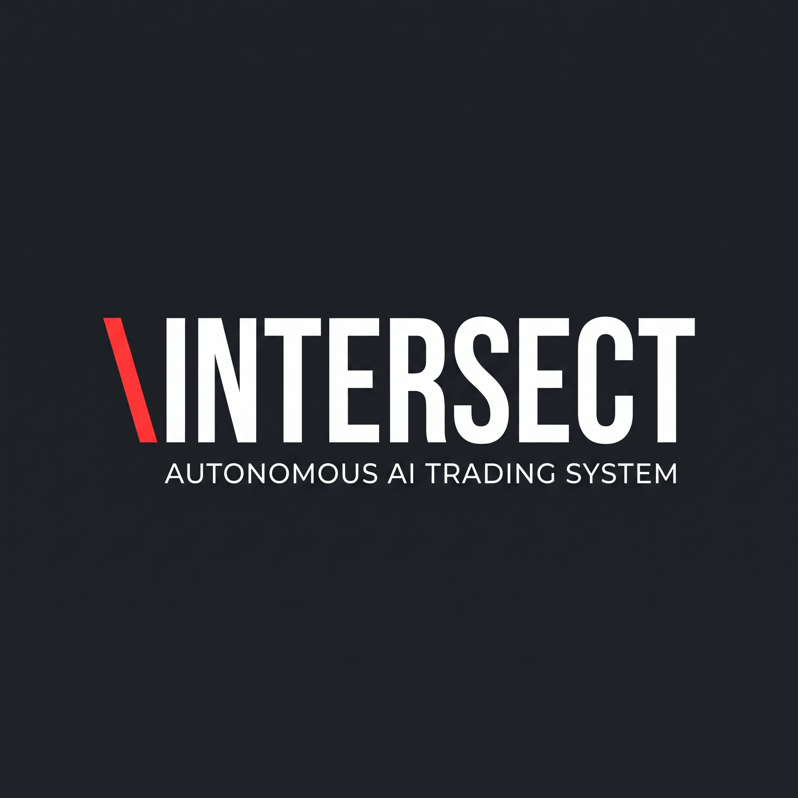

INTERSECT - Autonomous AI Cryptocurrency Trading System
========================================================

INTERSECT is a fully autonomous, self-healing cryptocurrency trading system that uses
deep reinforcement learning to trade ETH-USDT perpetual futures on the Bitget exchange.

Key Components:

1. REINFORCEMENT LEARNING AGENTS
   - PPO Agent: Uses a 2-layer LSTM network with separate actor/critic heads.
     Supports online learning, exploration mode, and rolling Sharpe tracking.
   - SAC Agent: Discrete Soft Actor-Critic with twin Q-critics, auto-entropy tuning,
     and soft target updates. Serves as a diversified secondary agent.

2. MARKET REGIME CLASSIFIER
   Uses a Hidden Markov Model (HMM) with automatic BIC-based state selection to
   classify market conditions (bull, bear, volatile, calm, etc.). Regime probabilities
   are fed directly into the RL observation space.

3. ENSEMBLE VOTING
   Combines PPO and SAC predictions using rolling Sharpe ratio as weights. Includes
   minimum Sharpe gating, position size boosting, and weighted probability averaging.

4. TRADING ENVIRONMENT (Gymnasium-compatible)
   Simulates realistic trading with commissions, slippage, 7 discrete actions
   (hold, long 1x/2x/3x, short 1x/2x/3x), max drawdown termination, and
   38-dimensional state space with 20+ technical indicators.

5. META-OPTIMIZER
   Uses CMA-ES (Covariance Matrix Adaptation Evolution Strategy) to optimize PPO
   hyperparameters. Candidates are validated through a 7-day paper trading simulation
   before being promoted to live trading.

6. SELF-HEALING DAEMON
   Background health monitor that checks every 5 minutes for:
   - Dead agents (recovers from checkpoints)
   - Negative Sharpe (triggers exploration mode)
   - Stuck equity (forces exploration)
   - Overfitting (increases dropout)
   - Feature drift (clears buffers, retrains regime model)
   - Cache warming (keeps JIT/LSTM caches hot)

7. CONTINUAL LEARNING LOOP
   Runs every 15 minutes. Fetches candles, gets regime classification, queries both
   agents, combines via ensemble voting, and executes trades with SL/TP orders.
   Manages periodic tasks: online updates (1 min), batch retraining (daily),
   regime retraining (weekly), meta-optimization (weekly), full retrain (monthly).

8. WEB DASHBOARD (FastAPI)
   Real-time cyberpunk-style terminal dashboard on port 8080 showing PPO/SAC Sharpe,
   regime states, exploration mode, trades, rolling metrics, and recent trades.
   REST API for runtime configuration and system metrics.

9. DATA INFRASTRUCTURE
   - Bitget API client with HMAC-SHA256 auth and retry logic
   - SQLite database for trades, daily metrics, and agent metrics
   - Memory-mapped NumPy array for RL experiences (100K capacity)

Technology Stack:
   Python 3.11, PyTorch, NumPy, Pandas, hmmlearn, CMA-ES, Gymnasium,
   FastAPI, Uvicorn, SQLite, Docker, Railway.app

Deployment:
   Containerized via Docker and deployed on Railway.app with persistent volumes
   for checkpoints, logs, models, and backups. Health checks and auto-restart
   with up to 10 retries.
